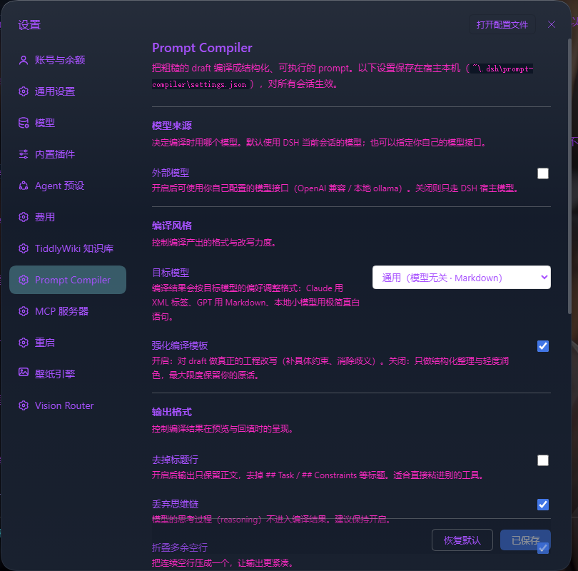
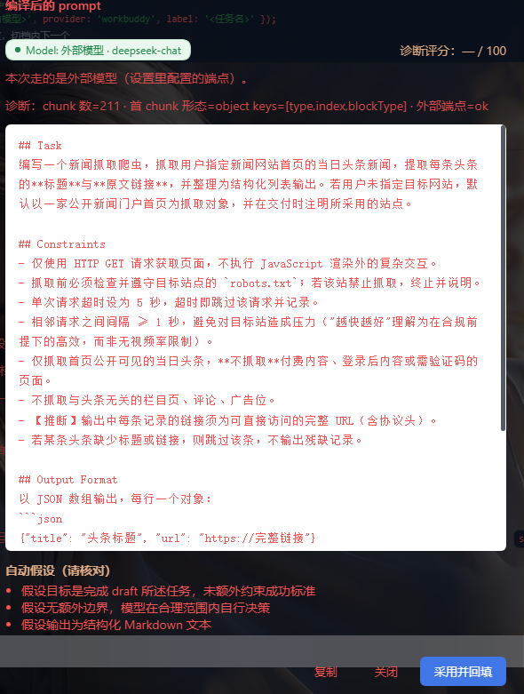
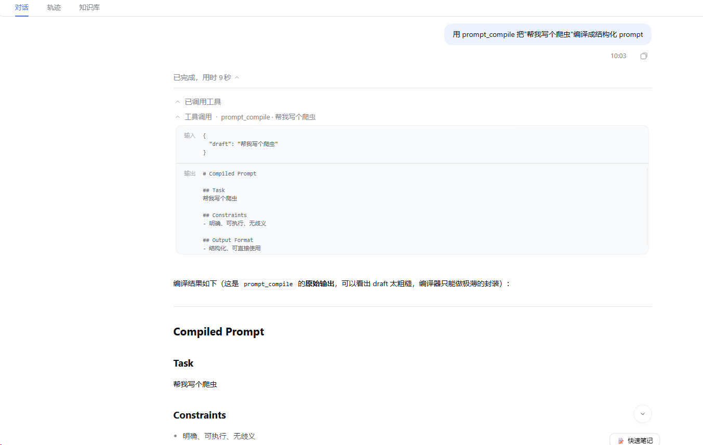
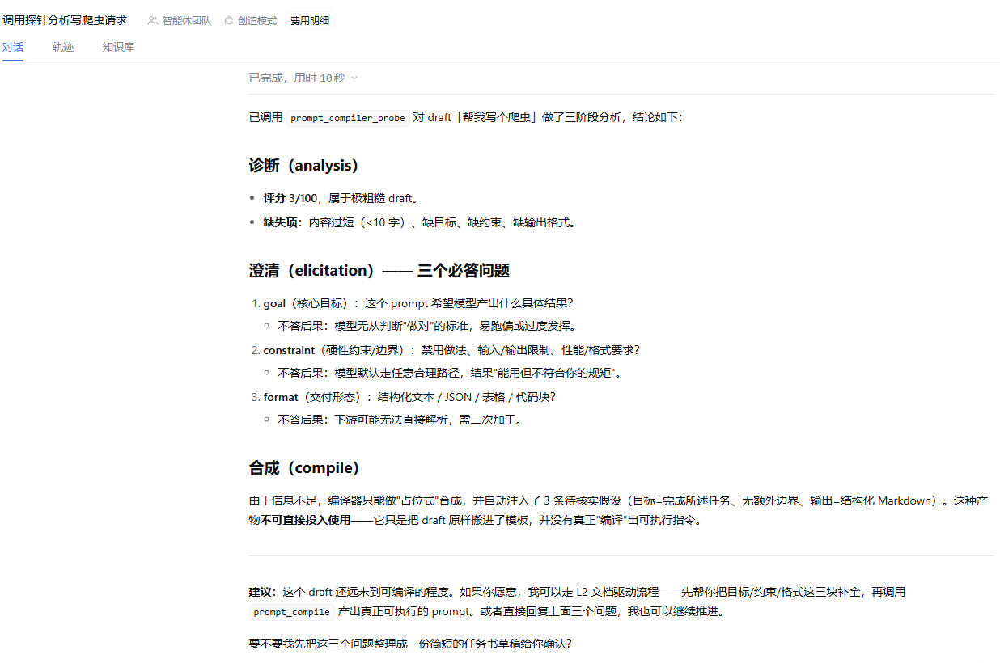
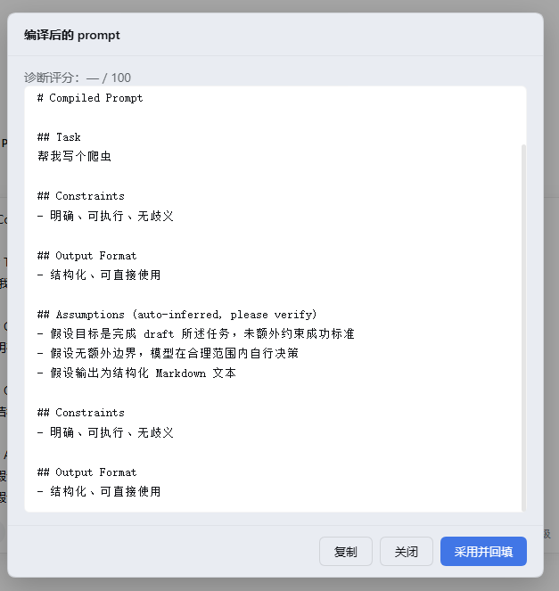
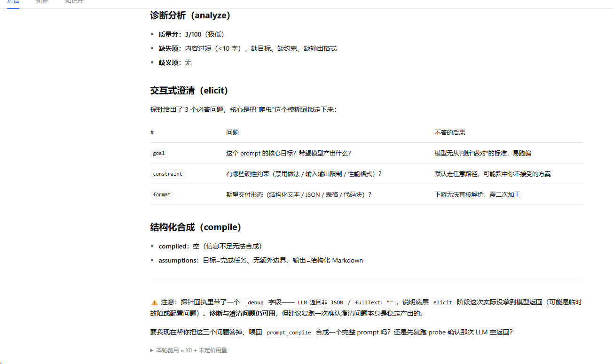

# dsh-prompt-compiler

> **把粗糙的 draft 编译成精确、完整、可执行的 prompt。**
> 诊断缺什么 → 交互式澄清 → 结构化合成。

它有两个身份：给**人**用的 UI 插件（composer 工具栏「✨ 编译」+ DSH 设置页），
以及一个**可编程的 prompt 编译层** —— 其他插件与 Agent 可以直接
`ctx.promptCompiler.analyze / elicit / compile / render`，或调用 `prompt_compile` / `prompt_template` 工具。

两条互补的编译路径：**`compile` 让 LLM 把草稿改写成 prompt**（适合形态未知的草稿），
**`render` 用模板确定性渲染**（适合"按固定维度评一遍"这类要求可复现的评审任务）。

[](https://www.npmjs.com/package/dsh-prompt-compiler)
[](https://www.npmjs.com/package/dsh-prompt-compiler)
[](https://github.com/Jav1es/dsh-prompt-compiler/actions/workflows/ci.yml)
[](./tests)
[](./LICENSE)
[](package.json)
[](package.json)



> 📄 一页版介绍（含 Before/After 数据、复跑方法、23 个仓库横向对照）：[docs/portfolio.html](./docs/portfolio.html)

---

## 问题：你的 prompt 大概率缺这五样

随手写的一句话指令，看起来没毛病，实际上把大量决策甩给了模型：

> `帮我写个爬虫，抓点新闻，越快越好`

本插件给它做体检，结果是 **12/100**，缺：目标的具体说明、约束条件（语言/库/robots/速度口径）、
上下文（运行环境、去重、存储）、验证标准、输出格式。

> **歧义维为什么是 0 而不是"扣分"**：这一条实质正文不足 20 字，评分器判定「无从评估歧义控制」，
> 明确给 0 而不是白送分。这是 F1 的抗刷分设计 —— 短到没什么可评的时候，**不装作评过了**。
> 换成长一点的草稿（如「帮我写个爬虫，抓点新闻，越快越好，别用 Selenium」），歧义维才会真正开始计分。

**同一个 draft，编译后长这样**（真实输出，节选）：

```markdown
## Task
抓取用户提供的新闻网站首页当日可见的新闻标题及其对应链接，整理为结构化列表。

## Constraints
- 仅使用 HTTP GET 方法发送请求。
- 严格遵守目标网站的 robots.txt 规则；若禁止抓取则终止任务。
- 单次请求间隔不得小于 1 秒；请求超时 5 秒，超时视为失败并跳过。
- 不抓取需要登录、付费或其他访问限制的内容；仅抓取公开可直接访问的新闻条目。
- 用户必须在调用时给出目标新闻网站的首页完整 URL（含 http/https 前缀）。

## Output Format
每条新闻占一行，采用纯文本 JSON：{"title": "<标题>", "url": "<绝对 URL>"}

## Acceptance Criteria
1. 每行的 title 非空，且 url 可直接访问（返回 HTTP 2xx）。
2. 输出条目之间没有完全重复的 title-url 配对。
3. 所有请求均尊重 robots.txt，且间隔 ≥ 1s、超时 ≤ 5s。
4. 若页面无法获取或无可识别的新闻条目，则输出为空且不报错。
```

差别不在文风，在于**原来靠模型猜的那些决策，现在被显式写成约束和验收标准**。

---

## 它不会让你干等（0.4.1）

慢和死看起来一模一样：界面纹丝不动，你不知道是在跑还是挂了。这一版专门治这个。

真实宿主上量到的 **215.7 秒**，同一条 draft 换成会话在跑的模型只要 **5.8 秒** —— 慢 37 倍。
三个原因叠在一起：

| 原因 | 修法 |
|---|---|
| 模型选择盲取 `listModels(provider)[0]`，拿到 `hy4-preview-f`（一次编译吐 **2250+ chunk**） | 改为**会话当前模型 → provider 优选档 → 列表首个**，且前两级都要在清单里确认归属（不靠名字猜） |
| `for await` 没有任何时限，宿主不结束就永远等 | **双层 deadline（默认 90 秒）**：逐 chunk 检查 + 外层 `Promise.race`。后者必需 —— 若一个 chunk 都不吐，内层检查永远轮不到执行 |
| 超时后还换 purpose/provider 重试 | **不重试**，那只是再等 90 秒。直接降级出结果 |

**超时不等于失败，等于降级。** 到点就给你一份规则式编译的粗糙结果，同时明确告诉你发生了什么：

```js
diag.timedOut        // true = 是我们主动放弃（太慢），不是宿主出错
diag.timeoutNote     // "模型调用超过 90 秒未完成，已放弃 LLM 链路并降级为规则式编译"
diag.modelUnavailable// 点名是哪个模型没调用成功，而不是只说一句"已降级"
```

前端加载态**每秒自增显示已用时**，超过 60 秒提示"超过 90 秒将自动改用规则式编译"。

> 这三条各有测试锁死（`tests/timeout.test.js`，9 条），并且**每条都用注入破坏验证过能被击穿** ——
> 去掉 `Promise.race` 会让测试进程直接挂死，这本身就是"没有 deadline 就会挂住"的证据。

---

## 三阶段

| 阶段 | 做什么 | 实现 |
|---|---|---|
| ① 诊断分析 | 识别 draft 缺什么（目标 / 上下文 / 约束 / 验证标准 / 歧义），给 0–100 评分与理由 | `ctx.llm.stream` |
| ② 交互式澄清 | 就缺失项提问，每个问题都附「**不答会怎样**」 | 规则实现（更快更可预测） |
| ③ 结构化合成 | 强制产出 Task / Constraints / Output Format / **Acceptance Criteria** 四段 | `ctx.llm.stream` |

全程**保留规则降级**：LLM 缺失、抛错、返回非 JSON、缺字段时，安全回落到规则实现，不抛错。

---

## 快速开始

```bash
# 从 npm 安装（推荐）
dsh plugin --profile desktop add npm:dsh-prompt-compiler

# 或从 GitHub 安装
dsh plugin --profile desktop add git+https://github.com/Jav1es/dsh-prompt-compiler.git
```

**重启 DSH**。然后在任意会话的输入框右侧看到「✨ 编译」按钮即生效。

> 需要 DeepSeek Harness `0.2.0-rc.2` 及以上，宿主已配置可用的 LLM provider。
> `link:` / 本地安装不跑 build，因此 `lib/` 已随仓库入库。

---

## 用法一：给人用

1. 在输入框写一句话 draft（别费心润色）
2. 点「✨ 编译」—— 编译中随时可点「**取消编译**」退出，草稿原样保留、可以直接改
3. 看诊断评分 → 回答澄清问题（不想答就跳过，会标注为「自动推断」）
4. 预览四段结果 → 「采用并回填」（**只回填，不会替你发送**）或「复制」



顶部徽章会明确告诉你**这一次是哪个模型在干活**（宿主模型 / 外部模型 · 模型名），
下方是编译结果，以及模型自行补上的「自动假设」供你核对 —— 不让你在黑暗里猜。

**编译中可以反悔。** 最慢的一步是等模型，不想等了就点「取消编译」——立刻回到输入框，
草稿一个字都不丢，改完再编：


### 不想临时想变量？用模板

除了「把草稿编译成 prompt」，还有一条**确定性**路径：「📋 模板」。
模板按固定维度与输出结构渲染，**结果可复现、不消耗模型调用**；变量表单按模板 schema
自动生成，所以新增模板不用改前端。


---

## 用法二：给插件与 Agent 用（差异化核心）

这是本项目的落点。**编译能力不该被锁死在某个 UI 里** —— 任何插件都能拿到它：

```js
// 消费方插件：声明依赖后即可使用
export const inject = ['promptCompiler']

export function apply(ctx, config) {
  // 1) 只要诊断
  const { missing, ambiguities, score, reasoning } = await ctx.promptCompiler.analyze(draft)

  // 2) 只要澄清问题（每问带 why）
  const { questions } = await ctx.promptCompiler.elicit(draft)

  // 3) 要成品
  const { compiled, assumptions, degraded } = await ctx.promptCompiler.compile(draft, {
    answers:      { goal: '...' },     // 澄清答案（可选）
    targetModel:  'claude',            // 'claude' | '' (通用) | 'local'
    strongTemplate: true,              // false = 温和模式，只整理不重写
    format:       { stripHeadings: false, collapseBlank: true },
    extPriority:  false,               // true = 外部模型优先，失败回落宿主
  })
}
```

Agent 侧则有开箱即用的工具：给一句粗糙指令，模型可以自己调 `prompt_compile` 把它编译好再执行。

服务经**宿主 `ctx.provide('promptCompiler', ...)`** 注册，`lib/` 内**零 `@deepseek-ai` 运行时 import** ——
这一点是踩坑换来的，见下方「关键踩坑」。

---

## 用法三：模板编译（评审类任务）

有些任务**不该让模型自由发挥** —— 「按这套固定维度把我的主页评一遍」，
如果每次维度不同、输出结构也变，结果就不可比、不可复现。这类任务走**模板**：

```js
// 确定性地渲染：不调 LLM、零成本、同一输入永远同一结果
const { ok, text, errors } = ctx.promptCompiler.render('portfolio-review', {
  siteUrl: 'https://jav1es.github.io/portfolio/',
  targetRoles: ['企业级 AI Agent 开发工程师', 'FDE'],
  background: {
    years: '5 年+',
    metrics: ['RAG 93.3% @3', '6 个 MIT 开源', 'CI 全绿'],
  },
  coreSkills: ['企业级智能体', 'RAG', '评测与可观测性', 'MCP'],
})

// 有哪些模板、各自要什么变量
ctx.promptCompiler.listTemplates()
```

Agent 侧对应工具是 `prompt_template`（**不传 `template` 就会先列出可用模板**）。

**也可以在 UI 里用**：composer 工具栏的「📋 模板」按钮 → 选模板 → 填变量（表单按模板的
`variables` schema 自动生成）→ 渲染 → 「采用并回填」（**仅回填，不发送**）。
它与「✨ 编译」是**并列的两个入口**，不是编译的一个选项。

**`render` 与 `compile` 的分工** —— 刻意做成两个并列能力，而不是重载 `compile`：

| | `compile(draft, options)` | `render(templateId, vars)` |
|---|---|---|
| 干什么 | 让 **LLM** 把粗糙草稿改写成 prompt | 用**模板**渲染出 prompt |
| 确定性 | 否（每次可能不同） | **是**（同输入同输出） |
| 成本 | 一次模型调用 | **零** |
| 适合 | 形态未知的草稿 | 要素固定的评审 / 转换 |

### 内置模板

| id | category | 说明 |
|---|---|---|
| `portfolio-review` | review | 作品集 / 个人主页评审。四个视角（简历顾问 / UIUX / 技术招聘 / HR）、**10 个评估维度**、按招聘方真实浏览节奏（5 秒 / 30 秒 / 2 分钟）分析，输出 **9 段带 P0–P2 优先级**的整改清单；含"无法访问网址时不许编造"的兜底 |
| `code-review` | review | 代码审查。6 维度（正确性 / 边界与异常 / 安全 / 性能 / 可维护性 / 测试）、6 段输出、阻断 / 严重 / 建议三级；含"不要把风格偏好伪装成缺陷"的约束 |
| `prompt-review` | review | Prompt 评审。0–100 评分 + 缺失要素 / 歧义点 / 改写前后对照 / 可直接复制的补强段 |

> **命名诚实**：这三个模板都是**自研**的，不挂任何外部框架名。曾有人把其中两个设想为
> "CLARITY / PRECISE" 并声称出自某开源仓库 —— 实际查证后该仓库**没有**这两个框架
> （它有 CRISPE / RACEF / RISEN / RTF / TAG 等 60+ 个），公开来源也查不到。
> 凭空宣称出处是诚信问题，所以宁可如实标注为自研。

**模板是数据，引擎是代码。** 加模板 = 往 `lib/builtin-templates.js` 加一个对象，
不用碰引擎；维度、输出结构、约束都在 `defaults` 里，改配置即可。
渲染失败（变量缺失 / 模板名错）返回结构化 `errors`，**不抛异常**。

> **两种"未定义"的语义刻意不同**：输出位 `{{x}}` 缺变量**直接报错**
> （静默渲染成空最难发现）；条件位 `{{#if x}}` 缺变量按"假"处理
> （这本就是"有才渲染"的惯用法，否则可选变量根本没法写）。
> 写错路径的风险由模板注册时的**静态审计**兜底告警。

**加一个模板要改几处？一处** —— 往 `lib/builtin-templates.js` 加一个数据对象即可：
引擎不用动，**UI 也不用动**（变量表单由 `variables` schema 自动生成），
工具与路由自动带上。`render()` 的边界情况（缺变量 / 模板名错）返回结构化 `errors`，**不抛异常**。

---

## 设置

**DSH 设置 → Prompt Compiler**。五组配置，全部落到宿主本机
`~/.dsh/prompt-compiler/settings.json`（client / host 两侧读同一份），对所有会话生效。

| 组 | 你能调什么 |
|---|---|
| **模型来源** | 用宿主当前会话模型，还是接你自己的端点（**宿主优先-外部兜底** / **外部模型优先** 二选一） |
| **编译风格** | 目标模型（Claude XML / 通用 Markdown / 本地小模型极简直白）、强化模板 vs 温和模板 |
| **输出格式** | 去掉 `##` 标题行、丢弃思维链、折叠多余空行 |
| **诊断与提示** | 模型徽章（区分宿主/外部）、诊断评分、技术细节、降级警告 |
| **默认行为** | 编译后自动回填、显示自动假设 |

**外部模型**支持任意 OpenAI 兼容端点（DeepSeek / OpenAI / LM Studio / vLLM / LocalAI…）
或本地 ollama。响应体形状自适应，失败原因会经 `diag.extFailReason` 明确告诉你，不静默吞掉。

**API Key 只落宿主本机，界面不回显明文**（显示为「已设置，留空不变」）。

---

## 更多截图

| 工具调用回执 | 服务化（可编程层）证据 |
|---|---|
|  |  |
| `prompt_compile` 被模型识别、调用、返回四段模板 | `prompt_compiler_probe` 返回 analysis + elicitation + compile 三段可解析 JSON |

| 完整链路（诊断 → 澄清 → 预览 → 回填） | LLM 接入回执 |
|---|---|
|  |  |
| composer「✨ 编译」到「采用并回填」全流程 | `analyze` / `compile` 走 `ctx.llm.stream` 的实调回执 |

---

## 诚实披露

> 这一节会随着竞品调研不断**收紧**。凡是调研推翻了的说法，都在这里改回来，而不是悄悄删掉。

- **不宣称「首创交互式澄清」**。`yaoshuo530/dsh-prompt-enhancer`（2026-08-28）已实现
  「判断是否需要澄清 → 澄清卡片 → 结构化提问」完整链路，早于本项目。
- **不宣称「首创可编程 prompt 服务」**。`seven282/oss-prompt-optimizer` 已有
  `ctx.promptOptimizer` 服务 + `prompt_optimize` 工具；`SongMiao-tech/dsh-prompt-optimizer` 同样暴露服务。
- **「五维评分」也不是独特名目**。`Y1X1n/dsh-prompt-optimizer` 自称「五维诊断」，
  `xueccci/dsh-prompt-lab` 有评分弹窗与继续优化。
- **本项目真正的差异点（有证据，不是修辞）**：
  1. **评分规则式、确定性、零模型成本** —— 竞品评分依赖 LLM，每次结果漂移；本项目同一输入恒得同分
     （`tests/scoring.test.js` 有确定性断言，`tests/eval.test.js` 有"连跑两次逐条比对"）。
  2. **公开评测集 + 可复现数字** —— 12 条真实 draft：平均 17.2 → 81.5；负向空壳恒 0 分。
     方法在 `evals/`，命令 `npm run eval`，任何人可复跑。
  3. **抗刷分与证据回溯是测试锁死的** —— 空壳必须 0 分、每处扣分必须指向原文片段，
     这两条在 `tests/` 里有断言并有注入破坏验证，不是宣传语。
- **`elicit` 走规则实现，不接 LLM** —— 这是设计选择（更快更可预测），不是未完成。
- **Claude Code 侧尚未实现**。跨端是方向，目前只有 DSH。

> 完整横向对比（**22 个 DSH 同类 + 1 个非 DSH 参照**，star / 日期现场查询可复现）：[docs/competitor-comparison.md](./docs/competitor-comparison.md)

---

## 关键踩坑（都已解决，写下来省你几小时）

1. **`messages[].content` 必须是内容块数组，不是字符串。**
   传字符串时宿主投影消息执行 `content.some(...)` 抛 `TypeError`，被 catch 成
   `finish/error` chunk —— 表面看是「模型不生效 / 静默降级」，实际是**契约用错**。
   排查时**先读 `reason.failure.message` 原文**，别急着怀疑策略拦截。
2. **`StreamChunk` 是判别联合**（`text-delta` / `reasoning-delta` / `block-start` / `block-end` / `usage` / `finish`）。
   见到 `.text` 就取会把思维链拼进正文；`block-end.block.text` 是该块的**完整文本**而非增量，
   直接累加会让输出重复两遍。
3. **reasoning-only 模型正文块可能只有 `block-end`、没有 `text-delta`**。
   兜底不能看「全局是否已有输出」（那时思维链早就写满了），要**按 `chunk.index` 记账**。
4. **`lib/` 内零 `@deepseek-ai` 运行时 import。** 早期用 `require('@deepseek-ai/cordis')`
   拿 `Service` 基类 `extends`，在 `link:` 安装下与宿主 asar 形成 **cordis 双实例**，
   服务注册静默失效。改为纯工厂函数 + 宿主 `ctx.provide` 注册后彻底消除。
5. **`npm publish --provenance` 要求 `package.json` 有 `repository` 字段**，
   否则 registry 直接 422（`Failed to validate repository information`），**代码根本没上传**。

---

## 项目结构

```
dsh-prompt-compiler/
├── lib/
│   ├── index.js      # host 半：工具 / 提示词 / HTTP 路由
│   ├── service.js    # promptCompiler 服务（analyze / elicit / compile / render + LLM 调用）
│   ├── templates.js  # 零依赖模板引擎（渲染 / 校验 / 静态审计 / 注册表）
│   ├── builtin-templates.js  # 内置模板数据（纯数据，加模板只改这里）
│   ├── settings.js   # 设置持久化（~/.dsh/prompt-compiler/settings.json）
│   ├── client.js     # client 半：UI + 设置页（零构建，手写 ModuleLoader）
│   └── sdk.js        # 自包含 defineTool
├── tests/            # node --test：12 个测试文件、192 个用例（见下表）
├── evals/            # 公开评测集：12 条真实 draft + 4 条负向样本，npm run eval 复跑
├── scripts/          # verify:static / verify:e2e / verify:prompt 三层验收脚本
├── docs/             # 竞品审计、官方文档对齐、服务化先例调研、一页版介绍页
└── .github/workflows/  # ci.yml（Node 22/24 矩阵）、release.yml（tag 自动发布）
```

| 测试文件 | 用例 | 锁住什么 |
|---|---:|---|
| `service.test.js` | 37 | LLM 流解析、provider 回退、外部端点、评分接入 |
| `scoring.test.js` | 23 | 五维评分规则与确定性（同输入恒同分） |
| `templates.test.js` | 17 | 模板引擎：渲染 / 校验 / 静态审计 |
| `verify.test.js` | 17 | 三层验收脚本自身 |
| `builtin-templates.test.js` | 15 | 三个内置模板的结构契约 |
| `index.test.js` | 15 | 工具注册、提示词守门、HTTP 路由 |
| `elicit-interactive.test.js` | 15 | 交互式澄清（`ctx.userQuestions`） |
| `auto-mode.test.js` | 14 | `agent/pre-step` 自动模式（默认关，双开关） |
| `client.test.js` | 11 | UI 结构冒烟（stub React，**测不出布局**） |
| `settings.test.js` | 11 | 设置持久化与默认值 |
| `timeout.test.js` | 9 | **90 秒 deadline、超时降级、模型优选** |
| `eval.test.js` | 8 | 评测集防劣化：增益与命中率下限 |

## 开发

```bash
npm ci         # 需 package-lock.json（CI 同款；lockfile 已入库）
npm run check  # 语法检查
npm test       # 192 个用例
npm run verify # 三层验收：static → unit → prompt → e2e
npm run eval   # 评测集：跑出 Before/After 那组数字
```

CI 在 Node 22.x / 24.x 上跑 `npm ci → check → test`。

**改 UI 注意**：`tests/client.test.js` 是结构性冒烟（stub React + 假 ModuleLoader），
只覆盖「结构 + 文案 + 条件渲染」，**测不出布局缺陷**。涉及浮层 / `position:sticky` /
滚动容器的改动，务必实机看一眼再发版。

## 版本

变更记录见 [CHANGELOG.md](./CHANGELOG.md)。

## License

[MIT](./LICENSE)
